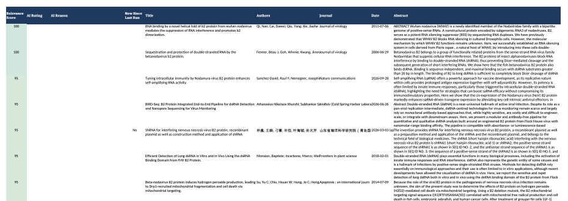
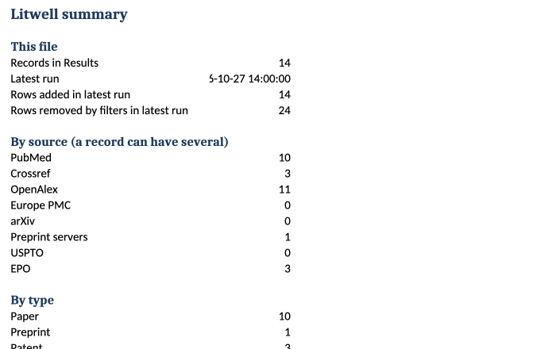

# Litwell

**Search the scientific literature, preprints and patents in one go, and get one tidy, ranked Excel file.**

Litwell is a free, open-source desktop app for Windows and Mac. You type a topic, tick the sources you want, and Litwell asks them all at once, removes duplicates, throws out the obvious misses, scores what is left, and saves everything to a single workbook. Nothing to install beyond the app itself, no account, no subscription.





## Contents

1. [What it does](#what-it-does)
2. [Download](#download)
3. [Quick start](#quick-start)
4. [Sources](#sources)
5. [Getting good results](#getting-good-results)
6. [The output workbook](#the-output-workbook)
7. [Free keys](#free-keys-uspto-epo-ncbi-openalex)
8. [Optional AI triage (local, free)](#optional-ai-triage-local-free)
9. [Run from source, command line, build](#run-from-source-command-line-build)
10. [Privacy](#privacy)
11. [Known limits](#known-limits)
12. [Contributing, license, credit](#contributing-license-credit)

## What it does

- **Eight sources at once:** PubMed, Crossref, OpenAlex, Europe PMC, arXiv, a group of preprint servers (bioRxiv, medRxiv, SSRN, OSF and more), USPTO patents and EPO worldwide patents.
- **Exact searches by default.** Searching `B2 Protein` finds that phrase, not every paper that mentions "B2" somewhere and "protein" somewhere else. You can also search for all the words or any word.
- **Precision tools:** a *Must also contain* list, an *Exclude terms* list, and named **profiles** you can save and reuse.
- **One row per paper.** A paper found by several sources is merged into one row, and missing authors, dates, DOIs and abstracts are filled in from the other copies.
- **Abstracts, citation counts and free full-text links** where the sources provide them.
- **A relevance score (0 to 100)** for every row, best first. It is a transparent rule, explained in the app, with no AI and no key needed.
- **Optional AI triage** with a model running on your own computer (Ollama). Off by default.
- **A workbook you can work from:** Results, Summary, Search Log and Glossary sheets, a "New since last run" flag, and a log that shows what every source and every filter did.

## Download

Get the newest version from the download page, which has *Download for Windows* and *Download for Mac* buttons: <https://kentmorgan1974.github.io/software/litwell/>. The files are also on the [releases page](https://github.com/kentmorgan1974/litwell/releases).

- **Windows 10/11:** download the `.exe` and open it. If Windows says "Windows protected your PC", click *More info*, then *Run anyway*.
- **Mac (Apple silicon and Intel):** download the `.zip`, unzip it, drag Litwell to Applications and open it. If macOS blocks it, go to *System Settings, Privacy & Security* and choose *Open Anyway*.

The apps are not code-signed (signing needs paid developer certificates), so the first launch shows that one-time warning.

## Quick start

1. Open Litwell. Choose **File, Set Output File** and pick where the workbook should live (for example `My Search.xlsx`).
2. Type a **Topic / keyword** (for example `double-stranded RNA`).
3. Tick the **sources** you want. *Papers only* skips the two patent sources, which need free keys.
4. Click **Search**. The Status box shows each source as it answers.
5. Open the workbook (**Open File**). The best matches are at the top.

The **Help / How-to Guide** button opens the full guide as a PDF.

## Sources

| Source | Covers | Needs |
|---|---|---|
| PubMed | Biomedical literature (NCBI) | nothing |
| Crossref | Journal articles in all fields | nothing |
| OpenAlex | All disciplines, the widest coverage | nothing |
| Europe PMC | Biomedical literature plus preprints | nothing |
| arXiv | Physics, maths, computer science and more | nothing |
| Preprint servers | bioRxiv, medRxiv, SSRN, OSF-hosted servers, ChemRxiv, Research Square and more | nothing |
| USPTO | US patents and published applications | free key |
| EPO | Patents from about 100 offices | free key and secret |

The preprint source searches three free aggregators at once (OSF, the Europe PMC preprint index and OpenAlex) because the roughly 90 independent preprint servers in the [COAR DOAPR list](https://doapr.coar-repositories.org/repositories/) share no search interface. In a probe on 2026-10-06, 56 of the 90 were reachable; [`doapr_coverage.csv`](doapr_coverage.csv) lists each one.

If a source is ticked but cannot run (no key, server down, rate limit), the Status box says so in plain words, the other sources still run, and the Search Log records it.

## Getting good results

**Match mode.** *Exact phrase* (the default), *All words* (every word, any order) or *Any word*. Each source gets the query in its own native syntax. Crossref and EPO cannot match a phrase themselves, so Litwell checks their results against your phrase afterwards.

**Must also contain.** The title or abstract must hold at least one of these comma-separated terms, or the row is removed.

**Exclude terms.** A term in the title or journal name removes the row. A term found only in the abstract keeps the row but lowers its score.

**Profiles.** Save the topic, match mode, must/exclude lists, a plain-language description and the ticked sources under a name, then load it again with one click. Two clearly labelled examples are included (*Example: Ambiguous abbreviation* and *Example: Patent landscape*); delete them if you do not want them.

**Relevance score (0 to 100).** Up to 50 points when your topic appears as a phrase in the title (otherwise up to 30 for the share of its words in the title); up to 25 when it appears in the abstract (otherwise up to 15 for the share of words); 10 per *Must also contain* term found, up to 20; 5 for a journal or field match; minus 20 per exclusion term found only in the abstract, up to 40. Rows are sorted best first. *Hide scores below* removes weak rows.

A worked example, the ambiguous abbreviation "B2 Protein" (the B2 protein of nodaviruses, not vitamin B2 or HER2): a plain unquoted search across the sources returned 1,219 rows, of which only about 16% had B2, beta-2, FHV or dsRNA in the title and only 10 had the phrase "B2 Protein" in the title. The same search as an exact phrase returns 241 unique rows across all eight sources, and with the example profile 217, of which 117 score 50 or more and the top ones are on topic (test run on 27 October 2026; counts change from day to day).

## The output workbook

| Sheet | What is in it |
|---|---|
| **Results** | One row per paper, best first: Relevance Score, AI Rating, AI Reason, New Since Last Run, Title, Authors, Journal, Date, Abstract, DOI, Link, Open-access link, Citation count, Type (Paper, Preprint, Patent), a Yes/No column for each source, Search Date, Search Terms. Header frozen, autofilter on, abstracts wrapped. |
| **Summary** | Counts by source, type, year, AI rating and score band. |
| **Search Log** | One row per source per run (including errors and *Skipped: no key*), plus one row per filter rule with the number of rows it removed. |
| **Glossary** | Every column and scoring term explained. |

Searching again into the same file merges new records in (nothing is duplicated, extra sources are added to existing rows) and marks which rows are new since the last run. Files made by older versions are upgraded automatically. Other formats are still available (`.csv`, `.txt`, `.md`, `.ris`, `.bib`); they receive the same filtered, scored records but not the extra sheets.

## Free keys (USPTO, EPO, NCBI, OpenAlex)

Everything in Litwell is free. Only the two patent sources need a key, and both keys are free. Paste keys under **File, API Keys & Contact**.

- **USPTO:** sign in or create an account at <https://data.uspto.gov>, generate or copy your API key, and paste it into *USPTO API key*.
- **EPO:** register at <https://developers.epo.org>, create an app to get a Consumer Key and a Consumer Secret, and paste both into *EPO OPS key* and *EPO OPS secret*. The free tier allows about 4 GB of downloads a week.
- **NCBI (optional):** raises PubMed's limit from 3 to 10 requests a second. You probably do not need it: <https://www.ncbi.nlm.nih.gov/account/>, Settings, API Key Management.
- **OpenAlex (optional):** gives you your own daily allowance if you ever see "rate limit reached": <https://help.openalex.org/api/authentication/>.
- **Contact email (optional, blank by default):** if you add one, Crossref, OpenAlex and NCBI put you in their faster "polite" pool. It is stored only in the settings file on your computer.

## Optional AI triage (local, free)

If you install [Ollama](https://ollama.com) (free) and pull any model once, for example `ollama pull llama3.1`, you can tick **AI triage**. Litwell then asks the model, on your computer, to rate each record *Relevant*, *Maybe* or *Not relevant* with a one-line reason, judged against the profile's plain-language description ("What counts as relevant"). By default Litwell auto-detects an installed chat model and says which one it used (in the Status box and the Search Log); to choose one yourself, type its name under **File, API Keys & Contact, Ollama model**, which also lets you switch to a newer model with no update of Litwell. If Ollama is not installed or not running, the Status box says so in one line and the search carries on. Litwell never sends data to a cloud AI service, and refuses any Ollama address that is not your own computer.

## Run from source, command line, build

You need Python 3.10 or newer with Tk (the python.org installers include it).

```bash
python3 -m venv .venv
source .venv/bin/activate          # Windows: .venv\Scripts\activate
pip install -r requirements.txt
python app.py                      # the window
python cli.py --keyword "B2 protein" --match exact --must "protein,viral" --exclude "riboflavin,HER2" --source papers
python cli.py --list-profiles
python -m unittest discover -s tests
```

Command-line options: `--source` (comma list, `all` or `papers`), `--match exact|all|any`, `--must`, `--exclude`, `--min-score`, `--profile NAME`, `--ai`, `--max`, `--start`, `--end`, `--author`, `--title`, `--journal`, `--set-excel PATH`, `--set-contact-email`, `--set-patent-key`, `--set-epo-key`, `--check-dupes`, `--dedupe`.

**Building the apps.** `./build_macos.sh` makes `dist/Litwell.app`; `build_windows_onefile.bat` makes `dist\Litwell.exe`. A GitHub workflow ([`.github/workflows/build-release.yml`](.github/workflows/build-release.yml)) builds both on GitHub's machines and can publish a release. To release: raise `__version__` in `litsearch/__init__.py`, add a `CHANGELOG.md` entry, commit, then push a tag such as `v1.4.0` (it must match the version) or run the workflow with *Publish a release* ticked. A built app can be checked without opening a window: `Litwell --selftest`.

**Settings** live in `~/.litsearch_config.json` (Windows: `C:\Users\<you>\.litsearch_config.json`): output file, keys, ticked sources, profiles. Delete the file to reset everything.

## Privacy

Litwell runs entirely on your computer. Your searches go only to the public sources you tick (NCBI, Crossref, OpenAlex, Europe PMC, arXiv, OSF, USPTO, EPO), the same as typing them into those sites. Litwell has no server, no account, no analytics and no tracking, and collects nothing. Your settings, keys and contact email stay in a file on your computer and are sent only to the service they belong to (a key to its own service, the contact email to Crossref, OpenAlex and NCBI when you have set one). The optional AI triage talks only to Ollama on your own computer. The websites you search have their own terms of use and privacy policies.

## Known limits

- **Result counts.** *Max results* is per source and capped (500 for PubMed, 200 for most others, 100 for patents). Filters are applied to what was fetched, so a very loose search with a small cap can leave few rows after filtering; narrow the search or raise the cap.
- **Crossref abstracts** are present for only a minority of records, so a *Must also contain* rule can remove Crossref records that have no abstract. USPTO search results carry no abstract.
- **Citation counts** differ between databases; Litwell shows the highest figure found.
- **Dates** from PubMed are the electronic publication date when available.
- **Deduplication** is by DOI (case-insensitive), then by normalized title. Patent numbers sit in the DOI column.
- **Resilience.** Network errors, rate limits and server errors are retried with backoff; a long lock-out fails fast with the reset time instead of freezing the app.
- **Data terms.** Each database and patent office has its own terms of use, which you are responsible for following.
- **No app-window screenshot** is included in this README yet.

## Contributing, license, credit

See [CONTRIBUTING.md](CONTRIBUTING.md). Litwell is licensed under the **Apache License, Version 2.0** ([LICENSE](LICENSE), [NOTICE](NOTICE)); bundled third-party software is listed in [THIRD_PARTY_NOTICES.md](THIRD_PARTY_NOTICES.md).

> Litwell, Copyright (c) 2026 J. Kent Morgan Consulting, LLC. Created by J. Kent Morgan, Ph.D.

**Name and icon.** The Litwell name and icon are not licensed for use as the name of derivative products. You are welcome to fork and modify the code under the Apache License; please give a derivative product its own name and icon.
